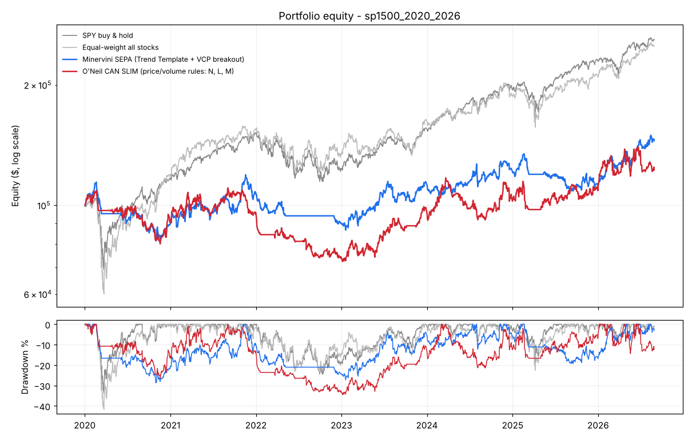
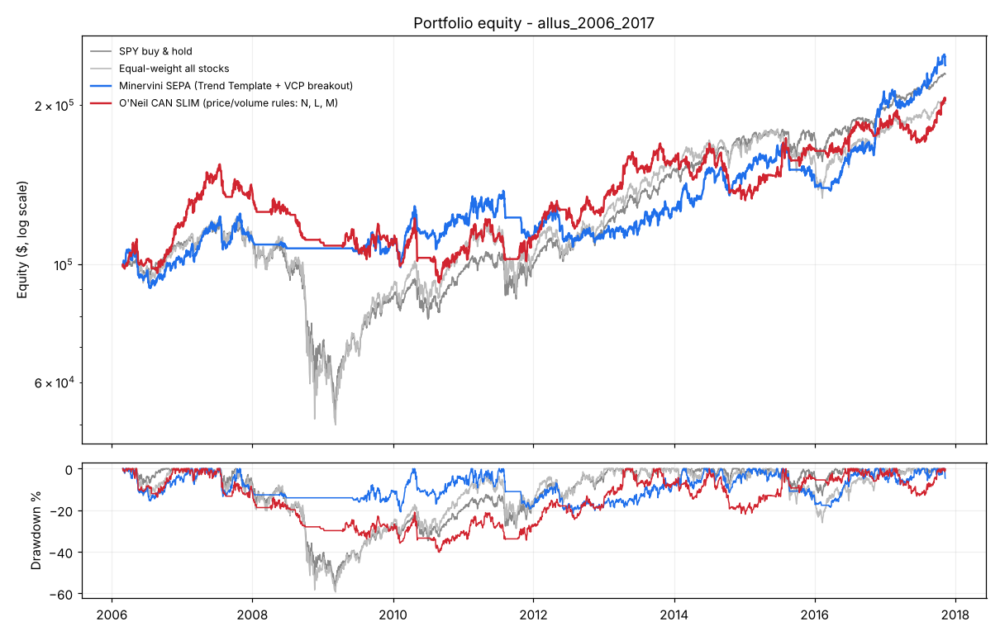

# דוח בדיקה: השיטות של אוניל ומינרביני על נתוני עבר

**הספרים:** ויליאם אוניל – *How to Make Money in Stocks* (CAN SLIM), מארק מינרביני – *Trade Like a Stock Market Wizard* (SEPA / VCP).
**תאריך הבדיקה:** נובמבר 2026. כל המספרים כוללים עמלה + החלקה של 0.1% בכל צד.

---

## השורה התחתונה

1. **אחוז ניצחון: 31%–39% מהעסקאות.** לא 50% ומעלה. הרווח הממוצע בעסקה מנצחת גדול פי 2–2.3 מההפסד הממוצע, ולכן השיטות קרובות לאיזון או ברווח קטן.
2. **2020–2026:** שתי השיטות הרוויחו **פחות** מהחזקה פשוטה של SPY: מינרביני 5.8% לשנה ואוניל 3.1% לשנה, מול 15.4% ל-SPY.
3. **2006–2017:** מינרביני הרוויח כמו SPY (7.7% מול 7.3% לשנה), אבל עם ירידה מקסימלית של **22% בלבד מול 57%**, כי מסנן השוק הוציא אותו מהשוק במשבר 2008.
4. **מול כניסות אקראיות** (אותם חוקי יציאה, מניות אקראיות): היתרון של הספרים **קטן ולא עקבי**. ברמת התיק, מינרביני ניצח את הכניסות האקראיות בשתי התקופות. אוניל ניצח רק באחת מהן.
5. **הסטופ (הנושא של הסרטון):** סטופ צמוד (3%, או 1.5×ATR) הוא הגרוע ביותר בכל הבדיקות. ב-**70%** מהפעמים שהוא הופעל, המניה חזרה מעל מחיר הקנייה תוך 20 ימי מסחר. סטופ של כ-3×ATR או 7.5%–10% עבד טוב יותר.
6. **המלצה:** לא לחבר כסף אמיתי למסחר אוטומטי לפי החוקים האלה כמו שהם. פירוט בסוף הדוח.

> "בוודאות" אי אפשר. מה שאפשר לתת זה **טווח ביטחון של 95%**: הטווח שבו אחוז הניצחון האמיתי נמצא כמעט בוודאות, בהינתן מספר העסקאות שנבדקו. הטווחים מופיעים בטבלאות.

---

## מה נבדק

| | מאגר 1 | מאגר 2 |
|---|---|---|
| תקופה | ינואר 2020 – אוגוסט 2026 | פברואר 2006 – נובמבר 2017 |
| מניות | 1,486 (S&P 500 + 400 + 600) | 5,784 (כמעט כל השוק האמריקאי, כולל מניות קטנות) |
| כולל | קורונה 2020, שוק דובי 2022, ירידות 2025 | משבר 2008, שוק שורי 2009–2017 |

**מינרביני:** כל 8 תנאי ה-Trend Template (מחיר מעל ממוצעי 50/150/200, ממוצע 200 עולה, לפחות 30% מעל שפל 52 שבועות, עד 25% מתחת לשיא, RS ≥ 70). בנוסף, פריצת VCP: התכווצות טווחים משמאל לימין, ייבוש מחזור, ופריצה מעל ה-pivot במחזור גבוה ב-40% לפחות מהממוצע. סטופ מתחת לשפל ההתכווצות האחרונה, עד 8% לכל היותר. אחרי רווח של פי 2 מהסיכון, הסטופ עולה לנקודת האיזון. יציאה בסגירה מתחת לממוצע 50.

**אוניל:** בסיס של 7 שבועות לפחות בעומק של עד 33%, ופריצה מעל ה-pivot במחזור גבוה ב-50% לפחות, עד 5% מעל ה-pivot. ליד שיא 52 שבועות, RS ≥ 80, מחיר ≥ $15. מסנן שוק (M): SPY מעל ממוצע 50 ופחות מ-6 ימי הפצה. סטופ 7.5%, מימוש רווח ב-+20%, וחוק 8 השבועות: אם המניה עלתה 20% תוך 3 שבועות, מחזיקים אותה 8 שבועות.
**לא נבדק:** רווחים (C ו-A ב-CAN SLIM), כי אין נתוני דוחות היסטוריים בחינם. ייתכן שזה החלק החשוב בשיטה.

**איך:** האות נקבע בסגירה, והקנייה מתבצעת בפתיחה של היום הבא. אין שימוש במידע מהעתיד. 8 בדיקות אוטומטיות מוודאות שהקנייה, הסטופ ויעד הרווח מתבצעים במחיר הנכון.

---

## 1. אחוז ניצחון – כל אות כעסקה

| | עסקאות | אחוז ניצחון (טווח 95%) | רווח ממוצע | הפסד ממוצע | Profit Factor | עסקה ממוצעת |
|---|---|---|---|---|---|---|
| **מינרביני 2020–26** | 2,131 | **31.1%** (29.1–33.1) | +12.1% | −5.2% | 1.05 | +0.18% |
| **אוניל 2020–26** | 2,777 | **32.6%** (30.9–34.4) | +15.8% | −7.0% | 1.09 | +0.45% |
| **מינרביני 2006–17** | 5,322 | **34.4%** (33.1–35.7) | +10.5% | −4.7% | 1.16 | +0.49% |
| **אוניל 2006–17** | 5,223 | **37.7%** (36.4–39.0) | +12.7% | −6.4% | 1.19 | +0.78% |

Profit Factor = סך הרווחים חלקי סך ההפסדים. מעל 1 פירושו רווח, ו-1.05–1.19 זה רווח דק.

## 2. האם הספר עדיף על בחירה אקראית?

אותם חוקי יציאה בדיוק, אבל קנייה של מניה אקראית ביום אקראי (3,000 עסקאות × 5 חזרות):

| | הספר: אחוז ניצחון / עסקה ממוצעת | אקראי: אחוז ניצחון / עסקה ממוצעת |
|---|---|---|
| מינרביני 2020–26 | 31.1% / +0.18% | 35.9% / +0.35% |
| אוניל 2020–26 | 32.6% / +0.45% | 36.4% / +0.88% |
| מינרביני 2006–17 | 34.4% / **+0.49%** | 36.3% / +0.24% |
| אוניל 2006–17 | 37.7% / +0.78% | 37.6% / +0.66% |

**מסקנה:** ברמת עסקה בודדת, כללי הכניסה לא נתנו יתרון ברור על פני כניסה אקראית. רק מינרביני ב-2006–2017 הגיע לבערך פי 2 מהאקראי. כמעט כל הרווח בא מ**חוקי היציאה**: לחתוך הפסדים מהר ולתת לרווחים לרוץ.

## 3. תיק של $100,000

סיכון של 1.25% מההון בכל עסקה, עד 20% מההון בפוזיציה אחת, עד 8 פוזיציות במקביל.

| | תשואה שנתית | ירידה מקסימלית | Sharpe | עסקאות | אחוז ניצחון |
|---|---|---|---|---|---|
| **2020–2026** | | | | | |
| SPY (קנה והחזק) | **15.4%** | −33.7% | 0.82 | – | – |
| מינרביני | 5.8% | −28.7% | 0.42 | 295 | 35.6% (30–41) |
| ↳ אותו תיק, כניסות אקראיות | 2.8% | −39.3% | 0.23 | | |
| אוניל | 3.1% | −34.5% | 0.25 | 338 | 31.4% (27–37) |
| ↳ אותו תיק, כניסות אקראיות | 4.6% | −35.6% | 0.33 | | |
| **2006–2017** | | | | | |
| SPY (קנה והחזק) | 7.3% | −56.5% | 0.46 | – | – |
| מינרביני | **7.7%** | **−21.7%** | **0.56** | 454 | 39.2% (35–44) |
| ↳ אותו תיק, כניסות אקראיות | 2.8% | −33.1% | 0.26 | | |
| אוניל | 6.4% | −40.2% | 0.46 | 480 | 35.4% (31–40) |
| ↳ אותו תיק, כניסות אקראיות | 3.0% | −29.5% | 0.27 | | |

תשואה לפי שנה (התיק):

| שנה | SPY | מינרביני | אוניל |
|---|---|---|---|
| 2020 | +17.2% | −9.2% | −7.9% |
| 2021 | +28.7% | +18.4% | +4.2% |
| 2022 | −18.2% | −15.9% | −22.6% |
| 2023 | +26.2% | +25.5% | +31.4% |
| 2024 | +24.9% | +7.2% | +5.0% |
| 2025 | +17.7% | −8.1% | +6.2% |
| 2026 (עד אוג׳) | +13.4% | +29.8% | +12.6% |

## 4. למה הסטופ קופץ מוקדם מדי? (הנושא של הסרטון)

אותן כניסות בדיוק, ורק שיטת הסטופ משתנה. "חזרה מעל הקנייה" = אחרי שהסטופ הופעל, המניה עלתה בחזרה מעל מחיר הקנייה תוך 20 ימי מסחר. כלומר נזרקנו מעסקה שהייתה מתאוששת.

**מינרביני 2020–2026**

| סטופ | אחוז ניצחון | חזרה מעל הקנייה אחרי הסטופ | תשואת תיק שנתית | ירידה מקסימלית |
|---|---|---|---|---|
| 3% קבוע | 16% | **73%** | −5.5% | −42% |
| 5% קבוע | 25% | 60% | 6.4% | −25% |
| 7.5% קבוע | 31% | 44% | 6.3% | −29% |
| 10% קבוע | 33% | 33% | 8.3% | −29% |
| 1.5×ATR | 20% | 69% | 1.7% | −39% |
| 3×ATR | 32% | 40% | **10.7%** | **−24%** |
| מתחת לבסיס (עד 8%) | 31% | 45% | 5.8% | −29% |

**אוניל 2006–2017**

| סטופ | אחוז ניצחון | חזרה מעל הקנייה אחרי הסטופ | תשואת תיק שנתית | ירידה מקסימלית |
|---|---|---|---|---|
| 3% קבוע | 21% | **74%** | 5.2% | −47% |
| 7.5% קבוע (הספר) | 38% | 47% | 6.4% | −40% |
| 10% קבוע | 41% | 37% | 6.9% | −38% |
| 1.5×ATR | 24% | 69% | 0.7% | −39% |
| 3×ATR | 38% | 44% | 7.9% | **−28%** |

(הטבלאות המלאות, לשתי השיטות ולשני המאגרים: [`SUMMARY_tables.md`](SUMMARY_tables.md))

**מה רואים:**
- סטופ צמוד נמצא בתוך "הרעש" היומי הרגיל של המניה. לכן ב-70% מהמקרים הוא נפגע והמניה ממשיכה בלעדיך. זה נכון בכל 4 הבדיקות.
- 3×ATR (פי 3 מהתנודה היומית הממוצעת) נתן את הירידה המקסימלית הנמוכה ביותר **בכל 4 הבדיקות**, ובתשואה היה ראשון או שני בכל אחת מהן.
- בין 7.5%, 10%, 3×ATR ו"מתחת לבסיס" ההבדלים קטנים ולא עקביים, כלומר זה בתחום המקרה. המסקנה החזקה היא רק אחת: **לא לשים סטופ צמוד מדי**.
- סטופ רחב יותר אומר פוזיציה קטנה יותר (כדי שהסיכון בכסף יישאר 1.25%). כך זה חושב בטבלאות התיק.

## 5. השוואה למה שפורסם

המספרים בטבלה לקוחים מחיפוש ברשת (רובם ממקורות משניים). לא אימתתי אותם מול המקור.

| מקור | מה דווח |
|---|---|
| מינרביני על עצמו (2021, דיווח עצמי) | אחוז ניצחון 44%–63%, רווח ממוצע פי 2.15 מההפסד הממוצע |
| הבדיקה כאן | אחוז ניצחון 31%–39%, רווח ממוצע פי 2.2–2.3 מההפסד |
| מסנן CAN SLIM של AAII (1998–2023) | 19.2% לשנה מול 5.7% ל-S&P. בלי עלויות, ועם ירידה בביצועים אחרי 2013 |
| קרן IBD 50 (FFTY), כסף אמיתי, 2015–2025 | כ-1.2% לשנה מול כ-12.5% ל-S&P 500 |
| בדיקות Trend Template של אתרי סורקים | כ-11%–12% לשנה עם ירידה מקסימלית של כ-35% |

יחס הרווח להפסד שקיבלנו דומה למה שמינרביני מדווח. אחוז הניצחון נמוך יותר, כנראה בגלל שיקול דעת, נתוני רווחים ובחירת מניות שאין בבדיקה ממוחשבת. גם הקרן שפועלת בכסף אמיתי לפי שיטת IBD פיגרה מאוד אחרי השוק בשנים האחרונות, וזה מתאים לממצא כאן לגבי 2020–2026.

## 6. מגבלות (חשוב לקרוא)

1. **הטיית שורדים:** שני המאגרים כוללים רק מניות שעדיין נסחרו בסוף התקופה. מניות שקרסו ונמחקו חסרות, וזה מנפח את כל התוצאות (גם את האקראיות).
2. **אין נתוני רווחים:** את C ו-A של אוניל ואת דרישות הרווח של מינרביני אי אפשר היה לבדוק.
3. **דפוסי גרף כנוסחה:** VCP ובסיס הם הגדרה ממוחשבת שלי. סוחר מנוסה מזהה אותם אחרת.
4. **RS:** הדירוג של IBD קנייני. השתמשתי בנוסחה המקובלת שמחקה אותו.
5. **מאגר 2020–2026** כולל רק מניות מתוך S&P 1500, בלי הנפקות חדשות קטנות, שהן בדיוק מה שמינרביני ואוניל אוהבים.
6. **מקור הנתונים:** Yahoo Finance דרך מאגרים ציבוריים ב-GitHub. 6 מניות עם נתונים שבורים הוצאו מהבדיקה.
7. **הספרים כ-PDF:** לא הורדתי עותקים פיראטיים. החוקים לקוחים מהכללים הידועים והמתועדים של הספרים. אם יש לך עותק חוקי, אפשר להצליב פרטים.

## 7. מה הייתי עושה עכשיו

1. **לא לחבר כסף אמיתי** לחוקים האלה כמו שהם: בשנים האחרונות הם הרוויחו פחות מקנה-והחזק של SPY.
2. **להוסיף נתוני רווחים היסטוריים** (ספק נתונים בתשלום). זה החלק החסר הגדול, ושם כנראה נמצא היתרון של הספרים.
3. **סטופ של 3×ATR**, לא צמוד.
4. **TradingView:** הסקריפט מוכן ב-`pine/kroxis_book_strategies.pine`, ואפשר לראות בו את האותות על הגרפים.
5. **MetaTrader 5:** קודם חשבון דמו ל-2–3 חודשים, ורק אם התוצאות דומות לבדיקה, לשקול כסף אמיתי בסכום קטן.
