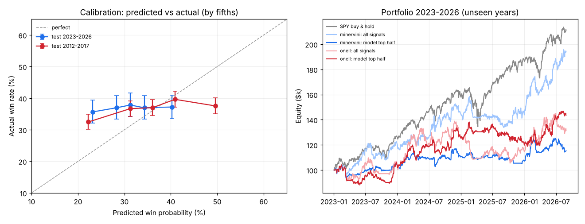

# אפשר לדעת מראש איזו עסקה תרוויח?

**התשובה הקצרה: לא.** ניסינו כמה שיותר, וזה מה שיצא.

## מה נבדק

- **15,422 עסקאות עבר** לפי חוקי הספרים, עם סטופ של 3×ATR: 10,543 עסקאות בשנים 2006–2017 ו-4,879 בשנים 2020–2026.
- לכל עסקה נשמרו **28 נתונים** מיום האות: RS, נפח הפריצה, עומק הבסיס, מרחק משיא 52 שבועות, תנודתיות, מרחק מהממוצעים, מצב השוק (SPY, ימי הפצה, כמה מניות מעל ממוצע 50) ועוד.
- שני סוגי מודלים: רגרסיה לוגיסטית ועצי החלטה (Gradient Boosting).
- **בדיקה הוגנת:** המודל למד על שנים מסוימות ונבדק על שנים שהוא לא ראה בכלל.

## התוצאה על 2023–2026 (שנים שהמודל לא ראה)

העסקאות חולקו ל-5 קבוצות שוות לפי הסיכוי שהמודל נתן להן:

| קבוצה | המודל אמר | בפועל הרוויחו (טווח 95%) | עסקאות |
|---|---|---|---|
| 1 (הכי "גרועות") | 23% | **35.7%** (32–39%) | 645 |
| 2 | 28% | 37.0% (33–41%) | 644 |
| 3 | 31% | 37.8% (34–42%) | 645 |
| 4 | 34% | 37.0% (33–41%) | 644 |
| 5 (הכי "טובות") | 40% | **37.2%** (34–41%) | 645 |

העסקאות שהמודל סימן כגרועות הרוויחו כמעט באותו אחוז כמו אלה שסימן כטובות. מדד הדיוק (AUC) יצא **0.51**, כש-0.50 הוא הטלת מטבע. בבדיקה השנייה (2012–2017) הוא יצא 0.52.
גם תיק שבחר רק את העסקאות שהמודל דירג גבוה **לא** הרוויח יותר מתיק שלקח את כל האותות.

## הגורם היחיד שעבד בעקביות: נפח הפריצה

| שיטה | נפח ביום הפריצה | עסקאות | אחוז ניצחון (טווח 95%) | עסקה ממוצעת |
|---|---|---|---|---|
| מינרביני | פי 1.4–2 מהממוצע | 5,112 | 32.0% (30.8–33.3) | +0.18% |
| מינרביני | פי 2–3 | 1,727 | 35.8% (33.6–38.1) | +0.85% |
| מינרביני | פי 3 ומעלה | 617 | **39.5%** (35.8–43.5) | +1.20% |
| אוניל | פי 1.4–2 | 4,546 | 36.0% (34.6–37.4) | +0.70% |
| אוניל | פי 2–3 | 2,416 | 37.4% (35.5–39.3) | +0.82% |
| אוניל | פי 3 ומעלה | 1,004 | **40.5%** (37.5–43.6) | +1.06% |

ככל שהנפח ביום הפריצה גדול יותר, הסיכוי קצת עולה. זה החזיק ב-3 מתוך 4 תקופות (לא ב-2020–2022).

## מה הסריקה היומית מציגה בעקבות זה

המודל לא נכנס לסריקה. במקומו מוצג **הסיכוי ההיסטורי** לפי השיטה ונפח הפריצה, מהטבלה למעלה, עם טווח 95%. זה המספר הכי כן שיש: בערך **32%–41% לכל עסקה**. השיטה מרוויחה כי העסקה המנצחת הממוצעת גדולה בערך פי 2 מהמפסידה הממוצעת, לא כי רוב העסקאות מצליחות.

הקוד: `scripts/train_model.py`. כל המספרים: `results.json`.
